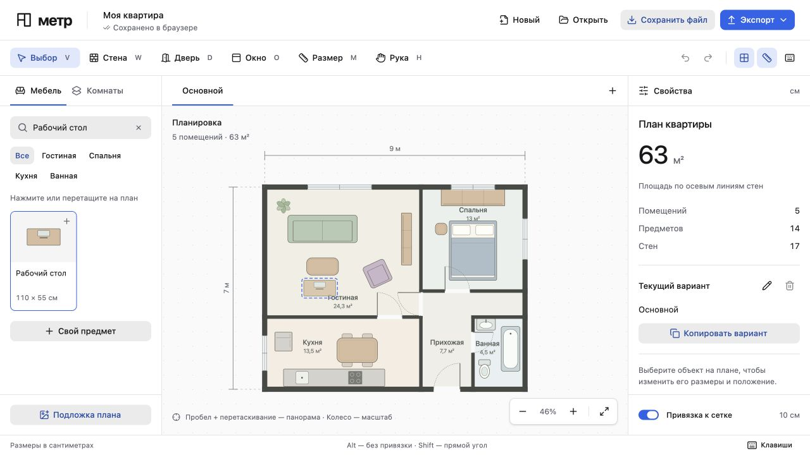

# Интерфейс редактора

Метр помогает составлять планировки. Основное место занимает чертёж; каталог и свойства доступны рядом с ним.

- Используем компоненты HeroUI v3 и их составные части: кнопки, вкладки, поля, меню, диалоги и уведомления. Специальные элементы чертежа остаются в SVG.
- Используем семантические токены светлой темы HeroUI. Акцент обозначает основное действие и выбор; цвет ошибки относится к ошибке или удалению.
- Сохраняем клавиатурное управление, видимый фокус, подписи полей и возврат фокуса после закрытия диалога.
- Отступы строим на шаге 4 px. Высоту элементов подбираем для плотного интерфейса редактора.
- Подписи называют действие или величину: «Ширина», «Копировать вариант», «Экспорт». В рабочих панелях нет рекламных заголовков.
- Размеры храним в сантиметрах; числовой ввод использует русскую локаль и десятичную запятую. Поле сохраняет значение при подтверждении или потере фокуса.
- На узком экране боковые панели открываются отдельно. Чертёж поддерживает масштабирование; при малом масштабе часть подписей скрыта.
- Экспорт строится из модели плана. Выделение, направляющие редактирования и элементы интерфейса в него не входят.

Основа: [принципы HeroUI](https://heroui.com/en/docs/react/getting-started/design-principles) и [стандартная тема](https://heroui.com/react/DESIGN.md).

## Размеры и отступы

| Элемент | Размер |
| --- | --- |
| Шапка приложения | 64 px |
| Панель инструментов | 56 px, на телефоне 104 px в два ряда |
| Шапки каталога, вариантов и свойств | 48 px |
| Нижние блоки боковых панелей | 64 px |
| Внутренний отступ панели | 16 px |
| Числовые поля и поиск | 36 px |
| Кнопки масштаба | 32 px, на телефоне 40 px |
| Инструменты рисования на телефоне | 40 × 40 px |
| Радиус кнопок, полей и карточек | 8 px |
| Основной текст управления | 13 px |
| Вторичные подписи | 12 px |
| Строка состояния и размеры в каталоге | 11 px |

Ширина боковых панелей составляет 256 и 288 px. При ширине окна до 1200 px они сужаются до 232 и 264 px. До 920 px каталог открывается отдельно, до 680 px так же открываются свойства. Панели используют высоты шапки и нижней навигации из общих CSS-переменных.

Строка вариантов использует CSS Grid. Ширина действий резервируется по содержимому. Длинные названия сокращаются многоточием, выбранная вкладка прокручивается в видимую область при переключении и изменении ширины окна.

## Цвета и контраст

Акцент темы: `#2563eb`, текст на нём: `#ffffff`, вторичный текст: `#5f636d`. Выделение стен, проёмов и мебели использует один акцент. Цвета предметов и пола относятся к модели плана и задаются отдельно.

| Пара | Контраст |
| --- | --- |
| Белый текст основной кнопки и акцент | 5,17:1 |
| Вторичный текст и белая панель | 6,01:1 |
| Размерные подписи и фон холста | 5,15:1 |
| Подписи площади и предустановленные цвета пола | от 4,51:1 |

Контраст рассчитан по относительной яркости sRGB. Для обычного текста ориентируемся на [порог 4,5:1 из WCAG](https://www.w3.org/WAI/WCAG22/Understanding/contrast-minimum.html). До правки основная кнопка давала около 3,59:1. Рамки выделения и ручки редактирования в экспорт не попадают.

## Проверка интерфейса

В браузере проверены размеры 1440 × 900, 1280 × 720, 1024 × 900, 768 × 900, 390 × 844, 360 × 844 и 320 × 844. Горизонтального переполнения страницы нет. У видимых кнопок и переключателей инструментов обе стороны не меньше 24 px. Проверены каталог, свойства, длинное название варианта, сравнение и числовой ввод с запятой. Временный вариант для проверки удалён, исходный план сохранён.

Сборка и 52 теста проходят. Экспорт PNG открывается как изображение, SVG проходит XML-разбор и не содержит CSS-переменных, рамок и цветов выделения.

[Десктопный вид](docs/editor.jpg) · [Мобильный вид](docs/editor-mobile.jpg) · [Экспорт плана](docs/demo-plan.png)

## Подбор по заданию

Опрос занимает четыре шага: комнаты и цели, привычки и стиль, бюджет и неподвижные предметы, проверка задания. Запуск доступен при подключённом серверном провайдере. Служебных сообщений о способе генерации в результатах нет.

Результаты совмещают исходную и новую планировки в одном масштабе. Вертикальную границу можно двигать мышью, пальцем и стрелками. Home показывает новую планировку целиком, End показывает исходную. Положение разделителя у каждой карточки своё. Карточка содержит перемещения, покупки, а также содержательные объяснения и компромиссы агента. Пользователь открывает один вариант или добавляет все. Исходный план сохраняется, добавление отменяется целиком.

В первой версии стены, проёмы и коммуникации не меняются. Перестановки ограничены выбранными комнатами. Проверка связности использует сетку и не гарантирует точную ширину прохода. Высота мебели, свет, розетки и материалы неизвестны из 2D-модели.

Поиск мебели начинается с места и размеров. Ссылка ведёт на карточку из источников поиска, неизвестные размеры и цена явно помечаются. Время поиска не выдаётся за гарантию текущего наличия. Товарные предложения не сохраняются как постоянный каталог.

В публичном режиме фича выключена. Флаг проверяется сервером для генерации и товаров. Включение интерфейса в браузере не даёт доступа к закрытым методам.

Локальный Codex получает геометрию и схемы квартиры, сам задаёт координаты и исправляет их после проверки. Готовых кандидатов для выбора нет. В отдельной сборке для GitHub Pages интерфейс подбора исключён. [Результаты проверки агента](docs/agent-check.md).

Один результат показывает план и описание рядом на десктопе, на телефоне они идут друг под другом. Разделитель при открытии оставляет изменённый предмет видимым. Модель может оставить один вариант; карточки не добавляются ради количества.

## Каталог и перенос мебели

Общий селектор SVG растягивал плюс до размера рисунка. Размер иллюстрации теперь задаёт `.catalog-glyph`, плюс остаётся 14 × 14 px с отступом 8 px сверху и справа. На широком экране увеличивается только иллюстрация. Плюс виден при наведении и клавиатурном фокусе.

При переносе рисунок следует за курсором. На холсте он принимает масштаб плана и привязку к координатам. Превью не попадает в проект, историю или экспорт. Отпускание над холстом добавляет один предмет; Escape, потеря фокуса и отмена указателя завершают перенос без добавления. Вертикальное движение пальцем сохраняет прокрутку каталога.

Проверено настоящим перетаскиванием в браузере: стол, стеллаж, торшер, один Undo после drop, Escape во время движения. Пробел на карточке добавляет предмет, панорама не перехватывает нажатие. Сохранение из активного числового поля учитывает введённую десятичную запятую.

На ширине 320 и 360 px нижние кнопки занимают четыре равных столбца, иконки стоят над подписями. Высота 48 px. При 768 px остаются три кнопки, свойства уже видны справа. Кнопка закрытия свойств появляется только когда панель открывается отдельно.

[Нижняя панель на 320 px](docs/editor-mobile-320.jpg)
