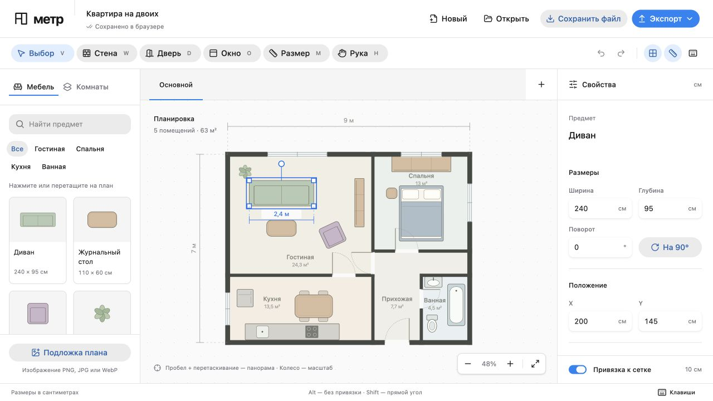

# Метр

Редактор квартир в браузере. Нарисуйте план с точными размерами, расставьте мебель и сравните варианты.

[Открыть Метр](https://sheinid.github.io/metr/)



[Пример экспортированного плана](docs/demo-plan.png) · [Мобильный интерфейс](docs/editor-mobile.jpg)

## Запуск

Требуется Node.js 22.12+.

```sh
npm install
npm run dev
```

Vite напечатает адрес локального сервера. Приложение открывается с демонстрационной квартирой площадью 63 м². Через «Новый» можно создать пустой план.

```sh
npm run build
npm test
npm run preview
```

## Что работает

- Связанные стены, разбиение в точках пересечения, замкнутые помещения и расчёт площади по осям стен.
- Рисование стен по точкам, перемещение стены и её вершин, числовые размеры и толщина.
- Двери и окна, привязанные к стенам, изменение ширины и направления открывания дверей.
- Каталог мебели с живым превью при перетаскивании. На холсте видны размер и привязка будущего предмета; Escape отменяет перенос. Размеры, положение, поворот, цвет и ссылка на товар редактируются в свойствах.
- Копии планировки, переключение вариантов и полупрозрачное наложение для сравнения.
- Подложка PNG/JPG/WebP с настройкой масштаба по известному отрезку.
- Отмена и повтор, автосохранение в localStorage, импорт и экспорт `.metr.json`.
- Экспорт текущего плана в SVG и PNG.
- Мышь, сенсорный экран, адаптивные боковые панели и горячие клавиши.

Все размеры в модели хранятся в сантиметрах. Проекты остаются в браузере; файл `.metr.json` содержит все варианты и изображение подложки. Подложки могут превысить квоту localStorage: приложение покажет сообщение, а проект можно сохранить файлом.

## Подбор планировок

Фича закрыта серверным флагом `METR_PLANNER_ENABLED`, по умолчанию `false`. В публичном окружении флаг должен оставаться выключенным. При выключенном флаге вход в опрос скрыт, генерация и поиск товаров возвращают HTTP 403. Параметры URL и настройки браузера не включают серверный API.

Опрос собирает комнаты, приоритеты, привычки, ограничения, бюджет в рублях и город. Можно запретить перестановку конкретных предметов. Результат содержит до трёх готовых вариантов со списком перемещений и заданием на покупки. Исходная и новая планировки совмещены в одном превью с подвижной вертикальной границей. Разделитель поддерживает мышь, сенсорный экран и клавиатуру. Выбранные варианты добавляются в проект одной операцией, которую можно отменить. Описания и задания сохраняются вместе с планом.

Агент сам проектирует расстановку и возвращает координаты каждого перемещения, размеры и положение новых предметов, предложения по замене. Код применяет эти координаты без подбора позиций. Стены, проёмы, коммуникации и закреплённые предметы сохраняются. Если провайдер не подключён, запуск подбора недоступен.

Проверка учитывает границы комнат, пересечения, открывание дверей, зоны использования, проход от входа и бюджет. Рабочее кресло проверяется вместе со столом; к обеденным стульям нужен подход сзади или сбоку. Агент получает исходную схему, затем изображения собственных вариантов и конкретные ошибки. Он исправляет их сам, максимум за четыре обращения. Даже первый валидный план проходит отдельный визуальный пересмотр моделью. Если допустимой расстановки нет, сервер возвращает ошибку. Автоматической запасной расстановки нет.

Связность проходов проверяется на сетке 20 см с отступом 30 см от мебели. Это приближение. По 2D-плану неизвестны высоты, розетки и освещённость. Прохождение геометрической проверки ещё не означает удобный интерьер. [Реальные прогоны и ограничения](docs/agent-check.md).

Для локального агента нужен установленный Codex CLI с выполненным входом ChatGPT:

```sh
codex login status
npm run dev:agent
```

Команда включает подбор только на `127.0.0.1`. Сервер запускает отдельный временный процесс Codex для каждого задания. Процесс использует текущий вход ChatGPT и модель OpenAI; отдельный API-ключ не требуется. Размеры, мебель, ответы на опрос и PNG-схемы этой геометрии уходят в OpenAI. Название проекта, подложка и товарные ссылки в запрос не входят. Для выбора другой доступной модели задайте `METR_CODEX_MODEL`.

Codex работает во временной папке с режимом `read-only`, без инструментов терминала, приложений, плагинов и пользовательской конфигурации. Задание ограничено по времени и прерывается при закрытии диалога. Доступ к локальному провайдеру требует локального соединения и заголовка Host с `localhost` или `127.0.0.1`.

Модель начинает с одного законченного решения. Дополнительные варианты нужны только для других полезных сценариев. Для подбора товаров Codex отдельно использует живой веб-поиск и открывает карточки магазинов.

Также поддерживается [Responses API](https://developers.openai.com/api/reference/responses/overview). Для этого скопируйте `.env.example` в локальный `.env`, задайте `OPENAI_API_KEY`, `METR_AI_MODEL`, `METR_AGENT_PROVIDER=openai` и включите флаг только для разработки. `.env` исключён из Git, ключ не передаётся в браузер.

Покупки ищутся под конкретный предмет, размер, бюджет, стиль и исключения через [веб-поиск](https://developers.openai.com/api/docs/guides/tools-web-search). Принимаются карточки из источников поиска; выдуманные ссылки, слишком большие или дорогие товары отбрасываются. Неподтверждённые цена и размеры помечаются отдельно. Рядом с результатом видна дата поиска, есть повторный запрос. Постоянного каталога с устаревающими ценами нет. Актуальную цену, наличие и доставку подтверждает магазин.

Production-сервер запускается после сборки:

```sh
npm run build
npm start
```

Он обслуживает `dist` и API на одном адресе. Без включённого серверного флага подбор недоступен. При статическом размещении `dist` без API точка входа также скрыта.

## GitHub Pages

Публичный редактор работает по адресу [sheinid.github.io/metr](https://sheinid.github.io/metr/). Сборка `pages` использует путь `/metr/` и исключает интерфейс подбора и запросы к его API. На Pages нет сервера агента. Публичная страница не подключается к локальному Codex.

После коммита изменений:

```sh
npm run deploy:pages
```

Команда собирает редактор, проверяет отсутствие кода агента и приватных путей, затем отправляет только `dist` в ветку `gh-pages`. Git использует обычный настроенный вход. Файл `build.json` содержит исходный коммит и `plannerEnabled: false`. GitHub Pages настроен на публикацию корня этой ветки.

## Горячие клавиши

| Действие | Клавиши |
| --- | --- |
| Выбор / стена / дверь / окно | V / W / D / O |
| Измерение / перемещение холста | M / H |
| Панорама | Пробел + перетаскивание |
| Весь план | F |
| Поворот предмета на 90° | R |
| Отключить привязку | Alt |
| Прямой угол при рисовании | Shift |
| Отмена / повтор | ⌘ или Ctrl + Z / Shift + Z |
| Дублировать предмет | ⌘ или Ctrl + D |
| Сохранить файл | ⌘ или Ctrl + S |
| Удалить выбранное | Delete / Backspace |
| Закончить рисование, снять выбор | Esc |

## Устройство проекта

React + TypeScript, HeroUI v3, Tailwind CSS v4, Vite и SVG. `src/model.ts` хранит модель и операции над планом, `src/geometry.ts` содержит геометрические функции, `src/storage.ts` проверяет импортируемые проекты. `PlanCanvas.tsx` отвечает за холст, `App.tsx` — за панели и действия пользователя. Геометрия не зависит от React и проверяется через Node.js test runner.

Первая версия работает в 2D. Следующие задачи: 3D-просмотр из общей модели, измерение проходов и более точные ограничения при изменении геометрии. Интерфейс использует системный шрифт и семантическую тему HeroUI. Внешних шрифтов нет. Обычный редактор хранит планы в браузере.

## Проверки

Production-сборка, типы клиента и сервера и 52 теста проходят. Тесты проверяют применение произвольных координат модели, обратную связь об ошибках, отсутствие запасного генератора, неподвижные предметы, бюджет, геометрию проходов, формат проекта, источник товарных ссылок и серверный запрет фичи.

В браузере проверены рисование, размеры, двери, перенос мебели, отмена, варианты и экспорт. Отдельно проверены живое превью стола до отпускания мыши, добавление стеллажа и торшера, привязка, отмена переноса по Escape и одна операция Undo после drop. Пробел добавляет предмет с выбранной карточки. Сохранение через ⌘S учитывает значение `93,5` из активного поля без предварительного Enter. Временные изменения тестового проекта отменены.

Проверены ширины 320, 360, 390, 768, 1024, 1280 и 1440 px. На 320 px все четыре нижние кнопки помещаются и имеют высоту 48 px. На 768 px свойства видны постоянно, лишняя кнопка их открытия скрыта. [Проверка интерфейса](DESIGN.md).

Для подбора проверены четыре шага опроса и доступность запуска только с подключённым агентом. Сравнение поддерживает мышь, стрелки, Home и End. Реальные модельные прогоны описаны отдельно в [отчёте](docs/agent-check.md). Публичная сборка исключает интерфейс подбора и обращения к его API.

Импорт JSON и подложки через системный выбор файла не прошёл сквозную браузерную проверку: автоматизация выбора файла завершилась ошибкой. Сами обработчики импорта и калибровка подложки реализованы.

## Интерфейс

Элементы управления собраны из HeroUI v3: кнопки, панели вкладок, поля размеров, поиск, меню, переключатели, диалоги и уведомления. Цвета интерфейса берутся из семантических токенов темы. Подписи описывают действия редактора; сведения о площади и положении объектов показаны рядом с соответствующими полями. Для числового ввода используется русская локаль React Aria, включая десятичную запятую.

Размеры панелей, палитра, расчёт контраста и результаты проверки семи размеров окна описаны в [DESIGN.md](DESIGN.md).

Ориентиры: [принципы HeroUI](https://heroui.com/en/docs/react/getting-started/design-principles) и [описание стандартной темы](https://heroui.com/react/DESIGN.md).
