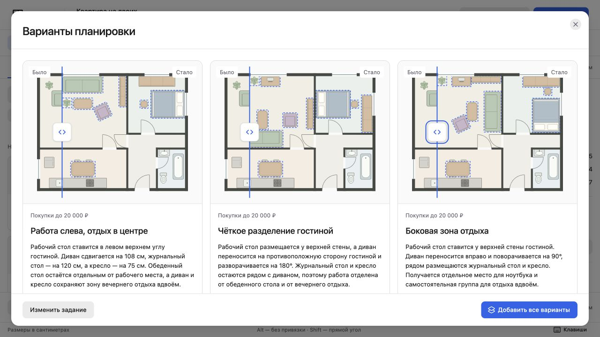
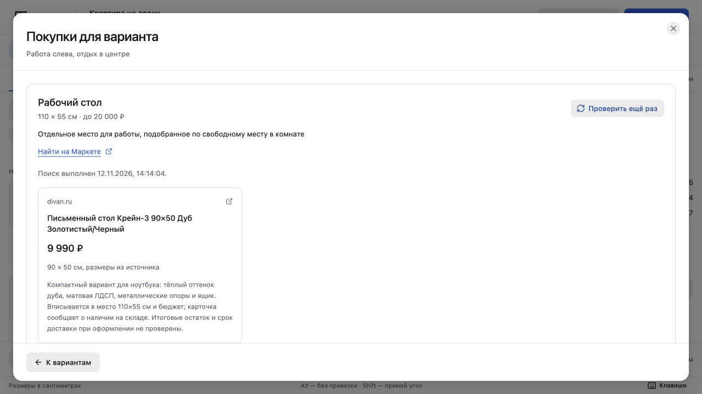

# Проверка локального агента

12 ноября 2026 года. Codex CLI 0.146.0, текущий вход ChatGPT, реальная модель OpenAI. Для проверки использована встроенная демо-квартира площадью 63 м². Личные планы не использовались.

## Задание

Два взрослых, работа за ноутбуком из дома. Нужно отдельное рабочее место вместо обеденного стола и место для вечернего отдыха вдвоём. Тёплое дерево, без стеклянных столешниц, глянцевого пластика и игровых акцентов. Общий бюджет 25 000 ₽, Москва. Стены, проёмы, кухня и сантехника остаются на месте.

## Планировки

Генератор рассчитал шесть кандидатов, проверил геометрию и передал их агенту. Модель выбрала три решения с отдельным столом 110 × 55 см в гостиной. Они различаются расположением дивана и зоны отдыха. Исходная квартира не менялась.

Агент выбирает и объясняет готовые кандидаты. Он пока не рассчитывает произвольные координаты мебели. Модельные пояснения требуют проверки на соответствие плану; генератор не знает расположения розеток, высоты мебели и освещённости.

В первом браузерном прогоне модель выдала лимит покупки за цену стола. После уточнения задания повторный прогон вернул описания без этой ошибки. Лимит показывается отдельным полем карточки.

Итоговые варианты: "Работа слева, отдых в центре", "Чёткое разделение гостиной", "Боковая зона отдыха". В браузере проверены сравнение, открытие варианта в редакторе и отмена добавления. После теста в проекте остался только исходный вариант.

## Мебель

В браузерном прогоне агент нашёл [Крейн-3 на Divan.ru](https://www.divan.ru/product/pismennyj-stol-krejn-4-dub-zolotistyj). Размер 90 × 50 см подходит под место 110 × 55 см. Карточка магазина подтверждает базовую цену 9 990 ₽. Она также показывает временную скидку по промокоду; агент вернул базовую цену.

В отдельном диагностическом прогоне прошли проверку ещё два предложения:

| Товар | Размер, Ш × Г | Цена при проверке |
| --- | --- | --- |
| [Прайм, Hoff](https://hoff.ru/catalog/ofis/mebel_dlya_ofisa/pismennye-stoly/komputernye-stoly/stol_pismennyy_praym_id11091314/?articul=80799255) | 110 × 52,2 см | 7 999 ₽ |
| [Poesy, INMYROOM](https://www.inmyroom.ru/products/1307184-stol-pismennyj-poesy-korichnevogo-cveta) | 100 × 55 см | 14 080 ₽ |

Ссылки пришли из настоящих веб-вызовов Codex. Завершённое событие открытия страницы подтверждает URL; ссылка из финального текста модели сама по себе не считается источником. В диагностическом прогоне третья карточка не прошла эту проверку и не появилась в результатах. Дополнительно проверяются магазин, бюджет и максимальные размеры.

Карточки магазинов открыты повторно при проверке результата. Цены, размеры и названия подтвердились. Поиск выполняется заново по запросу пользователя. Эти примеры не являются встроенным каталогом.

## Публичная версия

Сборка GitHub Pages не содержит интерфейса агента и обращений к `/api/planner`. В ней нет серверных файлов, ключей или подключения к локальному процессу. Обычный редактор, варианты и экспорт работают статически. Агент включается отдельно командой `npm run dev:agent` на локальном компьютере.
