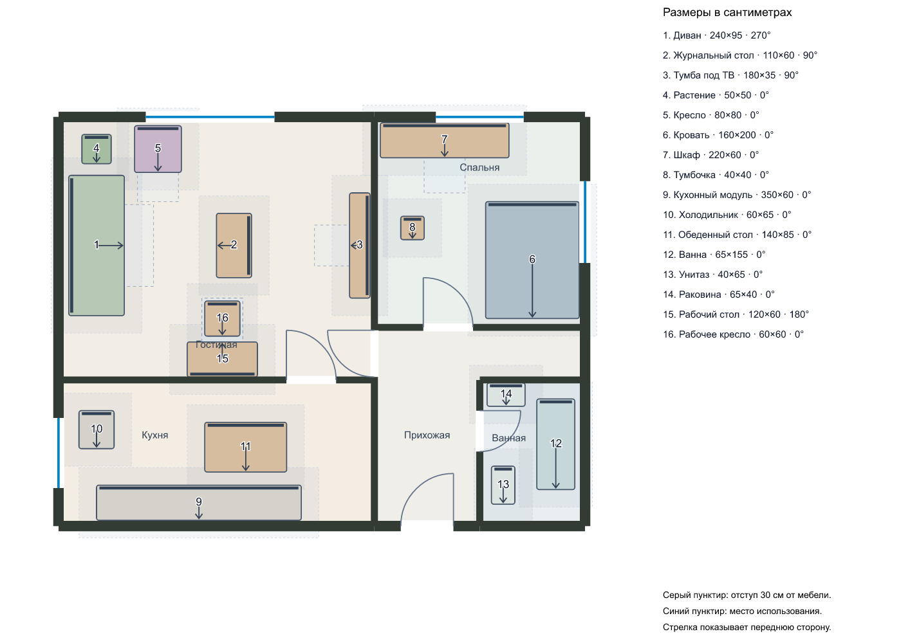

# Проверка самостоятельной расстановки

12 ноября 2026 года. Локальный Codex CLI 0.146.0 через вход ChatGPT, модель OpenAI. Использована демонстрационная квартира 63 м². Личных планов, адреса и подложки в запросах нет.

## Что изменилось

Старый генератор кандидатов удалён. Модель получает комнатные полигоны, мебель, проёмы, задание и PNG-схему. Она сама возвращает точные координаты, повороты, новые предметы и явные предложения по замене. Код не перебирает положения и не исправляет координаты. Он проверяет ограничения и возвращает модели ошибки вместе с изображением её собственного варианта.

Допускается до четырёх обращений. Первый вариант проходит повторный просмотр моделью даже без геометрических ошибок. Если за это время допустимого плана нет, сервер сообщает об ошибке и не создаёт запасную расстановку. Один качественно иной сценарий достаточен; три карточки не обязательны.

## Последний реальный прогон

Два взрослых. Нужен отдельный стол для ноутбука, обеденный стол надо сохранить только для еды. Разрешены осмысленные перестановки во всех комнатах. Общий бюджет 25 000 ₽. Стены, двери, кухня и сантехника неподвижны.

Модель вернула один вариант "Рабочая гостиная и спокойная спальня" за два обращения, 149 секунд. Она переместила восемь существующих предметов и добавила стол 120 × 60 см с лимитом 15 000 ₽ и кресло 60 × 60 см с лимитом 10 000 ₽. Это лимиты для последующего поиска, не цены товаров. Обеденный стол сохранён, удалений нет. Первая версия имела ошибки рабочей зоны. Во втором ответе модель сама изменила координаты кресла. Итог прошёл геометрию и повторный разбор формата проекта.

[Открываемый пример проекта](agent-demo.json) содержит исходную квартиру и результат. Его можно загрузить кнопкой "Открыть". Серый пунктир на диагностическом изображении показывает отступ 30 см, синий показывает зону использования. Эти линии нужны для проверки и не добавляются в обычный проект.

## Ограничения качества

Геометрически допустимый результат ещё требует оценки человеком. В последнем ответе модель назвала рабочий стол расположенным у окна, хотя он стоит у нижней глухой стены гостиной. Это ошибка объяснения. Проверка координат не устанавливает соответствие каждого текстового утверждения плану и не оценивает композицию интерьера.

Предыдущий прогон с тем же требованием сохранить обеденную зону не прошёл четыре попытки: модель не открыла путь к дивану. Сервер отклонил его. После этого модель получила явные названия типов мебели и схему отступов для прохода. Последний прогон прошёл, но один успешный пример не доказывает устойчивость на других квартирах.

Ещё один ранний прямой прогон прошёл за два обращения, 212 секунд. В его задании разрешалась замена обеденного стола рабочим, поэтому он не подтверждает сохранение двух отдельных функций.

Проходы проверяются на сетке 20 см с отступом 30 см от мебели. Рабочее кресло может занимать собственную зону перед столом, обеденный стул проверяется по свободному подходу сзади или сбоку. Высоты, розетки, размер экрана и освещённость из плана неизвестны.

## Поиск мебели

Поиск выполняется отдельно для конкретного предмета, его размеров, лимита и предпочтений. Принимаются только карточки, чей URL присутствует в завершённых веб-вызовах. Неизвестные цена и размеры сохраняются как неизвестные. Источник цены, наличие и доставку необходимо проверять у магазина при покупке.

После последней расстановки выполнен живой поиск стола под место 120 × 60 см и лимит 15 000 ₽. Агент вернул [Oregon на Hoff](https://hoff.ru/catalog/ofis/mebel_dlya_ofisa/pismennye-stoly/komputernye-stoly/pismennyy_stol_oregon_id6416083/?articul=80354122), размеры 120 × 60 см и цену 9 599 ₽ на момент запроса. Это данные ответа поиска, не сохранённая цена каталога. URL прошёл проверку по источникам завершённых веб-вызовов. Повторное открытие карточки отдельным браузерным поиском завершилось таймаутом, поэтому независимого повторного подтверждения цены нет. [Сохранённый ответ поиска](agent-products.json).

## Проверки и публикация

52 теста проверяют контракт модельного ответа, применение точных координат, обратную связь с изображением, отсутствие автоматической запасной расстановки, ограничения перемещения, бюджет, пары стола и кресла, обеденные стулья и проходы. Типы клиента и сервера, production-сборка проходят.

В браузере проверены четыре шага опроса и доступный запуск с локальным провайдером. Исторические снимки результатов старого генератора удалены. [Проверка редактора и живого превью](../DESIGN.md).

На GitHub Pages публикуется только редактор. Сборка исключает интерфейс подбора и обращения к `/api/planner`. Агент остаётся локальным и включается командой `npm run dev:agent`. Флаг публичного сайта выключен.
