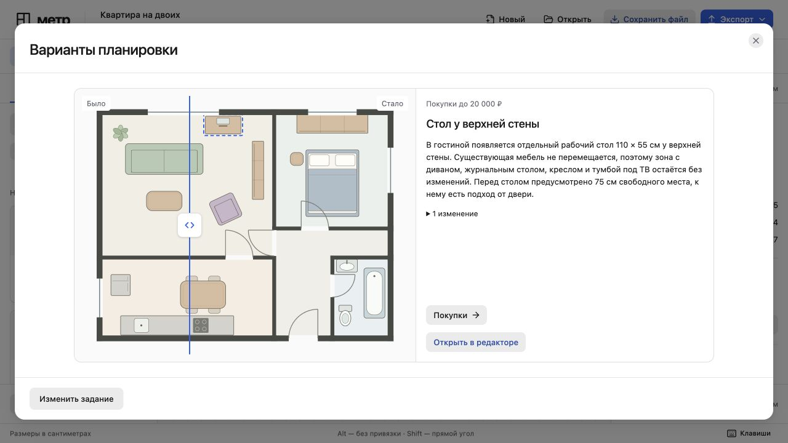

# Проверка качества расстановки

12 ноября 2026 года. Повторный прогон встроенной квартиры 63 м² с тем же заданием: отдельный стол для работы за ноутбуком, отдых вдвоём, бюджет 25 000 ₽. Использован локальный Codex с текущим входом ChatGPT.

## Что изменилось

Старый генератор перебирал стены комнаты и заново расставлял все подвижные предметы. Штраф за перемещение был слабым, а проверка проходов связывала двери между собой. Доступность нового стола она не проверяла. Разные UUID нового предмета также позволяли повторять одну геометрию под видом разных вариантов.

Теперь генератор сначала ищет место в существующей обстановке. При необходимости он может переместить не больше двух небольших предметов в той же комнате. Положение остальных комнат сохраняется. Для перестановки без покупок требуется измеримое улучшение по выбранной цели.

Перед рабочим столом проверяется свободная зона глубиной 75 см. Проверка проходов связывает входы с зоной использования нового предмета. Сетка имеет шаг 20 см, мебель при расчёте пути расширяется на 30 см с каждой стороны. Зоны использования существующей мебели защищены от новой покупки. Связи между диваном, столом, креслом и ТВ учитываются при оценке перестановок.

Генератор убирает дубли и близкие варианты. Агент получает названия и границы комнат, число перемещений, сохранённые комнаты и сведения о доступе. Он может выбрать один вариант. Требования заполнить три карточки нет.

## Результат на том же задании

| Проверка | До исправления | После исправления |
| --- | --- | --- |
| Перемещений существующих предметов | 8 или 9 в вариантах со столом | 0 |
| Спальня и кухня | Кровать, шкаф и обеденный стол перемещались | Все предметы сохранены |
| Изменения в гостиной | Переставлялась почти вся мебель | Добавлен только рабочий стол |
| Выбор реальной модели | Три перестановки всей квартиры | Один вариант у верхней стены |

Все 14 исходных предметов сохранили координаты, размеры и поворот. Генератор нашёл три места для стола. Модель оставила одно, которое сохраняет исходную зону отдыха.

На десктопе единственный результат показывает план и описание рядом. Начальное положение разделителя открывает изменённый предмет. На телефоне карточка складывается вертикально.

[Мобильный результат 390 × 844](layout-quality-mobile.jpg)

В браузере проверены опрос с реальной моделью, отсутствие выдуманных перемещений в описании, крайние положения сравнения, открытие результата в редакторе, повторное открытие и отмена добавления. После проверки остался только исходный вариант.

## Ограничения

Это геометрический подбор с проверкой бытовых связей, а не полная модель интерьера. Проверка на сетке не гарантирует точную ширину прохода. Высота мебели, свет и розетки неизвестны. Ошибки исходного плана в других комнатах не исправляются автоматически.

Публичный флаг агента остаётся выключенным. Код подбора исключён из сборки GitHub Pages.
